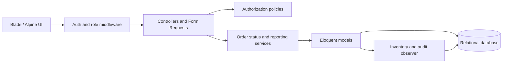
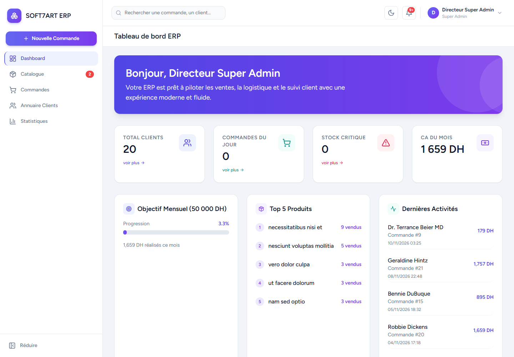
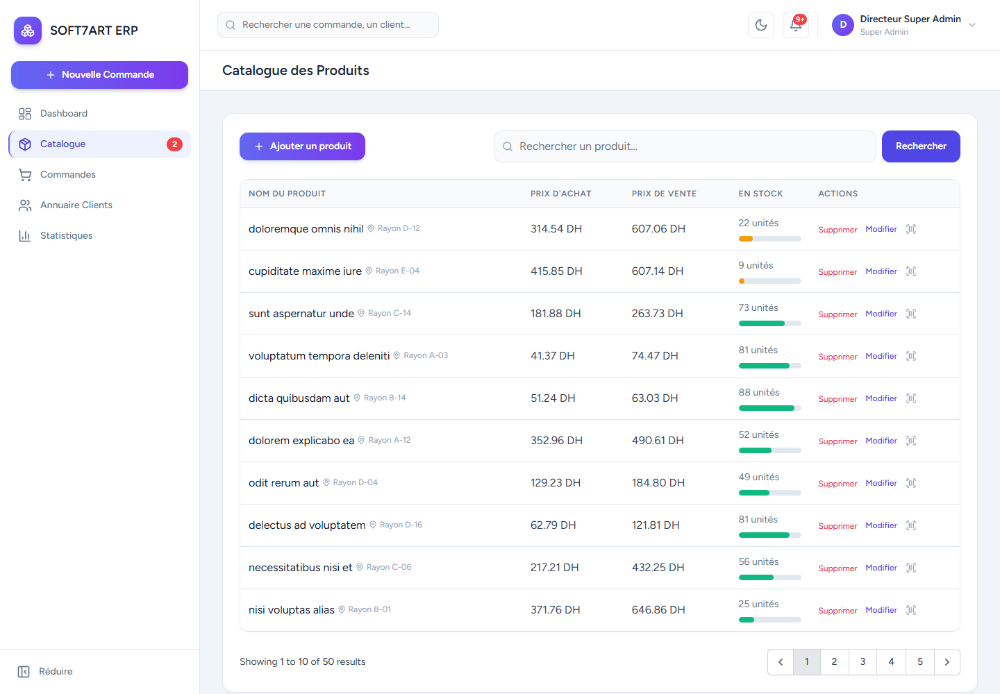
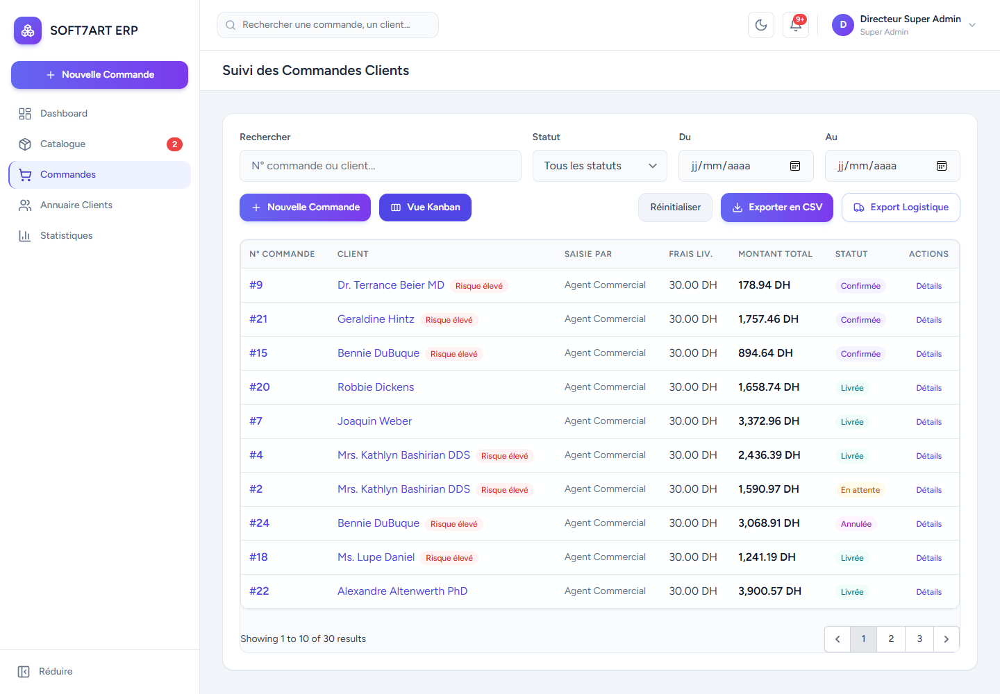
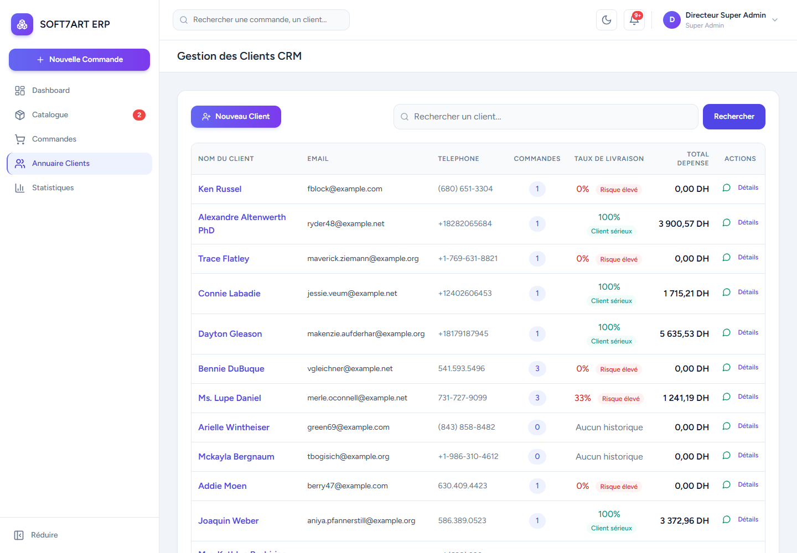
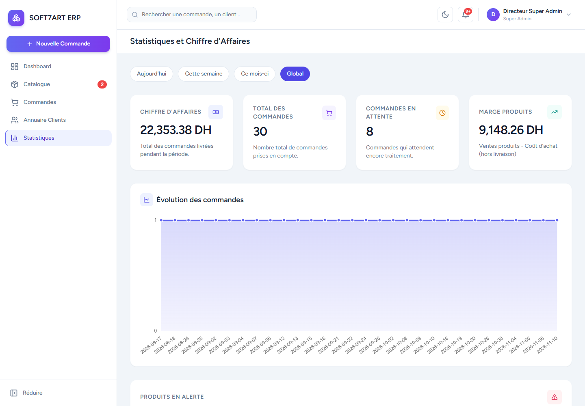
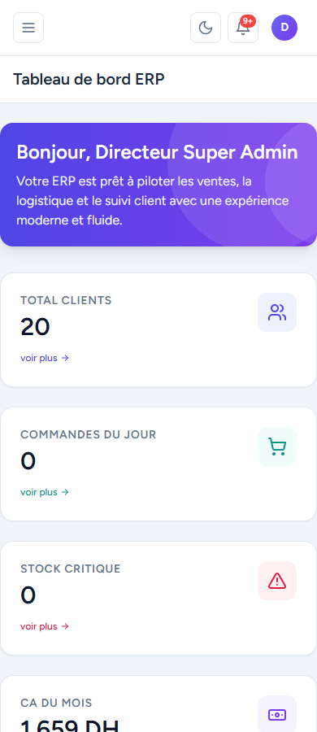

# SOFT7ART E-Commerce ERP

A Laravel application developed as a **2026 internship project**, presented as a software engineering portfolio for PFE 2027 applications. It brings inventory, sales orders, logistics and customer follow-up into a role-based workspace. The interface is in French; amounts are displayed in Moroccan dirhams (DH).

## Key Features

- Role-specific dashboards, stock alerts and delivered-order revenue.
- Product search, creation, editing, guarded deletion and printable barcode labels.
- Order creation with server-side prices, status history and transactional inventory movements.
- Logistics Kanban, CSV exports, PDF invoices and token-protected public tracking.
- Customer directory, order history and delivery-rate indicators.
- Product margin summaries and Chart.js order trends with period filters.
- Responsive Blade interface with light and dark themes.

## Technology Stack

| Layer | Technology |
| --- | --- |
| Backend | PHP 8.2+, Laravel 12.72.0 (composer.lock) |
| Authentication | Laravel Breeze, session authentication |
| Views | Blade, Tailwind CSS 3, Alpine.js 3 |
| Assets | Vite 7.3.8, Node.js 22 recommended |
| Reporting | Chart.js, Laravel Dompdf |
| Database | SQLite for demo/tests; MySQL configuration available |
| Quality | PHPUnit 11.5.58, Laravel Pint, GitHub Actions |

Lockfiles specify exact dependency versions. PHP 8.2.12 was used locally; use a maintained PHP patch release for hosting.

## Architecture

Conventional MVC with Form Requests, policies, reporting services and an order observer. See [architecture and business decisions](docs/ARCHITECTURE.md).



## Authentication and Roles

Public registration is disabled. Employee accounts require a trusted administrative provisioning process; no account-management UI is included.

| Capability | Director / super_admin | Sales / agent | Inventory / stock_manager |
| --- | --- | --- | --- |
| Dashboard and catalog | Yes | Yes | Yes |
| Purchase prices and product management | Yes | No | Yes |
| Orders, invoices, exports and CRM | Yes | Yes | No |
| Financial statistics | Yes | No | No |

Sales agents share the sales/CRM workspace, including each other's orders. This is intentional role-level access, not per-agent tenancy. Public tracking requires the complete unpredictable token URL; treat that link as confidential.

## Product and Inventory Management

Prices accept at most two decimal places; quantities cannot be negative. Products referenced by orders cannot be deleted. Low stock means fewer than 10 units; critical stock means fewer than 5. Stock is reserved at confirmation, not at pending-order creation, and checked again inside the confirmation transaction.

## Order and Logistics Management

```text
pending -> confirmed -> shipped -> delivered
pending -> canceled
confirmed -> canceled
shipped -> returned
delivered -> returned
```

Repeated requests for the current status are harmless. Canceled and returned orders are terminal. Confirmation subtracts stock once; cancellation after confirmation and returns restore it once. The service locks order and product rows within a transaction. SQLite does not exercise MySQL row-lock behavior.

Creation accepts one product line; historical/demo orders can contain multiple lines. Duplicate detection warns about a matching customer/product within one hour, without prohibiting legitimate repeat purchases.

## CRM and Analytics

Revenue includes only delivered orders, including the delivery fee charged to the customer. Product margin is delivered item sales minus purchase-cost snapshots. It excludes delivery charges and unmodeled operating costs; it is **not accounting net profit**. Legacy lines without snapshots use current product costs, so their margin is estimated.

Delivery rate is delivered orders divided by all customer orders, including pending orders. It is an operational indicator, not a credit score. Period filters use order creation dates, not delivery dates. The DH 50,000 monthly goal is a fixed demonstration target.

## Screenshots

Actual application captures using a disposable database containing fictional data:

| Dashboard | Catalog |
| --- | --- |
|  |  |
| Orders | CRM |
|  |  |
| Statistics | Mobile |
|  |  |

[Logistics Kanban](docs/screenshots/kanban.png)

## Installation

Requirements: PHP 8.2+ with PDO SQLite, mbstring, XML/DOM, fileinfo and OpenSSL; Composer 2; Node.js 22 and npm.

```bash
git clone https://github.com/Riri-the-one/soft7art-ecom-erp.git
cd soft7art-ecom-erp
composer install
npm ci
cp .env.example .env
php artisan key:generate
```

On PowerShell, use `Copy-Item .env.example .env` and `npm.cmd` if execution policy blocks npm.ps1. Do not replace an existing .env.

## Environment Configuration

Use `DB_CONNECTION=sqlite` and set `DB_DATABASE` to the absolute path of a **new empty** SQLite file, such as database/portfolio-demo.sqlite. Create that file with your editor or `New-Item database/portfolio-demo.sqlite -ItemType File` in PowerShell. Never point demo/test commands at an existing business database.

Keep APP_KEY private. For hosting use APP_DEBUG=false, HTTPS and SESSION_SECURE_COOKIE=true. The default log mailer avoids real email during local exploration. No real credentials are supplied.

## Database Setup

After checking the connection targets your new demo file:

```bash
php artisan migrate
```

For fictional data only, temporarily set `DEMO_SEEDING=true` in the local .env, then run `php artisan db:seed`. The seeder requires local/testing environment and explicit opt-in. It creates demo accounts at admin@example.test, agent@example.test and stock@example.test, then prints a newly generated password for that run. Keep it locally, never in GitHub. Set DEMO_SEEDING=false afterward. Seed once into an empty database; it is not a reset command.

For existing installations, back up the database and review pending migrations before running `php artisan migrate`. The new cost-snapshot column is nullable and does not fabricate historical costs.

## Running the Application

```bash
npm run build
php artisan serve
```

Open http://127.0.0.1:8000. For asset development, run `npm run dev` in another terminal. Confirmation email requires SMTP configuration outside this repository.

## Automated Tests

```bash
php vendor/bin/phpunit
php vendor/bin/pint --test app routes database tests
composer validate --strict
npm run build
composer audit
npm audit
```

Tests force SQLite in memory and supply a test-only encryption key. See [testing evidence and browser reproduction](docs/TESTING.md). GitHub Actions runs build, style, tests and dependency audits; check the actual remote run before claiming CI success.

## Security Considerations

Authentication, login throttling, CSRF protection, validation and role policies protect internal actions. Sales views hide purchase costs. CSV exports neutralize spreadsheet formulas. PDF remote resource loading is disabled. Account deletion is rejected when it would erase order/audit history. Demo seeding is opt-in with generated temporary credentials. Environment files, databases, logs, dependencies and audit artifacts are excluded from Git.

## Known Limitations

- MySQL concurrency and migration execution were not validated locally; SQLite covers rollback and stale-model retries.
- Legacy margins use current costs when snapshots are absent. No tax, refund ledger or complete accounting model exists.
- Some reports and CRM relations still load all relevant records; large datasets need measured SQL aggregation and pagination improvements.
- Charts, icons and fonts depend on external CDNs. Tracking links have no expiry/rotation UI.
- Breeze verification routes exist, but User does not implement MustVerifyEmail; employee access does not require verified email.
- No multi-tenancy, payment gateway, employee administration UI or production deployment is included.

## Future Improvements

Validate MySQL row-lock concurrency in CI, aggregate reports in SQL, bundle CDN assets locally, and add separate shipping-cost/accounting fields when real requirements justify them.

## Portfolio Notes

[Final report](docs/FINAL_REPORT.md) · [Architecture](docs/ARCHITECTURE.md) · [Testing](docs/TESTING.md) · [GitHub presentation](docs/GITHUB_PRESENTATION.md)
